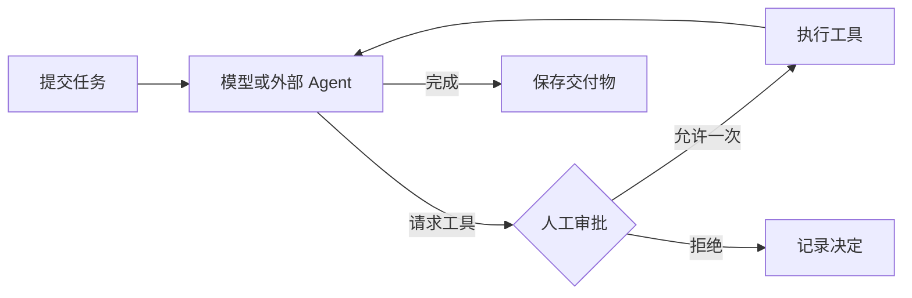

<p align="center">
  
</p>

# 面向工作任务的 Rust Agent 内核

Fliuno 将模型、工具和外部 Agent 接入同一个持久任务。任务可以暂停等待人工审批；客户端断线后，可以用游标补读事件，并下载保存在本地的交付物。

[快速开始](#快速开始) · [文档中心](docs/README.md) · [应用协议](docs/protocol.md) · [更新记录](CHANGELOG.md)

**`0.0.3` 开发中** · [已发布版本 `0.0.2`](CHANGELOG.md#002) · 应用协议 `0.1` · Windows / Linux

## 快速开始

### 跑一次离线任务

在仓库根目录运行。需要 **Rust 1.89+**、系统 C/C++ 构建工具和 Python。示例使用内置模型和临时数据库，无需 API Key。

```sh
python examples/demo.py
```

你会看到任务进入 `waiting_approval`，随后示例客户端批准一次工具调用。任务完成后，脚本会输出产物数量并回放事件。想看拒绝分支，可以加上 `--deny`。

[环境与配置](docs/setup.md) · [离线示例源码](examples/demo.py)

### 接入自己的客户端

应用服务通过 stdin 和 stdout 收发逐行 JSON-RPC。启动服务后，发送下面的握手请求：

```sh
cargo run -p fliuno-app-server -- --db .fliuno/kernel.db
```

```json
{"jsonrpc":"2.0","id":1,"method":"initialize","params":{"protocolVersion":"0.1","clientName":"my-client"}}
```

握手后，依次调用 `workspace/open`、`session/create` 和 `task/start`。Rust 调用方可以直接用类型化客户端；需要 HTTP 与 SSE 时，可以把 AG-UI 适配器挂到自己的宿主上。

[stdio 协议](docs/protocol.md) · [Rust 客户端](docs/protocol.md#rust-调用方) · [AG-UI HTTP](docs/ag-ui.md#http-接入)

## 一项任务如何运行



任务状态、审批决定、事件和交付物都保存在 SQLite。重连时，客户端可以把历史回放接到实时订阅；下载时，可以分段读取交付物并校验 SHA-256。

| 想进一步了解 | 从这里读 |
| --- | --- |
| 事件游标、断线续读与产物下载 | [Rust 客户端](docs/protocol.md#rust-调用方) · [AG-UI 事件](docs/ag-ui.md) |
| OpenAI、Anthropic、Gemini 和外部工具、Agent | [模型配置](docs/setup.md#真实模型) · [MCP / ACP / A2A](docs/README.md#模型工具与-agent) |
| 宿主注册命令和 PTY、平台隔离与资源预算 | [本机执行与隔离](docs/README.md#本机执行与隔离) |
| Rust 模块、状态机和持久化边界 | [内核架构](docs/architecture.md) · [注册身份与授权](docs/authority.md) |

## 开发与验证

`pwsh -File scripts/check.ps1` 检查格式、Clippy、工作区测试、协议 Schema 和离线演示。

[检查与演示](docs/setup.md#检查与演示) · [验收与性能记录](docs/execution-evidence.md) · [开发路线图](docs/roadmap.md)
