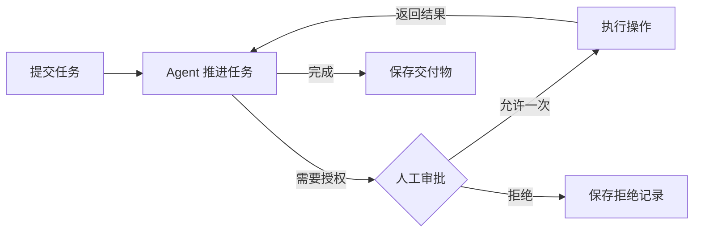

<p align="center">
  <picture>
    <source media="(max-width: 540px) and (prefers-color-scheme: light)" srcset="docs/assets/fliuno-cover-compact-light.svg">
    <source media="(max-width: 540px)" srcset="docs/assets/fliuno-cover-compact.svg">
    <source media="(prefers-color-scheme: light)" srcset="docs/assets/fliuno-cover-light.svg">
    
  </picture>
</p>

# Fliuno · 面向工作任务的 Rust Agent 内核

Fliuno 是为桌面工作台和宿主应用设计的 Rust Agent 内核。交给它一项工作：需要授权时由人决定，完成后在本机留下交付物和执行记录。

**[跑一次离线任务 ↓](#跑一次离线任务)** · **[接入自己的客户端 ↓](#接入自己的客户端)** · [文档中心 →](docs/README.md)

| 开发版本 | 已发布 | 应用协议 | 本机执行 |
| --- | --- | --- | --- |
| `0.0.3` | [`0.0.2`](CHANGELOG.md#002) | [`0.1`](docs/protocol.md) | [Windows / Linux](docs/sandbox.md) |

## 快速开始

### 跑一次离线任务

在仓库根目录运行。请先准备 **Rust 1.89+**、C/C++ 构建工具和 Python。演示用内置模型和临时数据库启动真实的本机服务，无需 API Key。

```sh
python examples/demo.py
```

```text
Task: waiting_approval
Proposed tool: artifact_create
Result: completed
Artifacts: 1
```

看到 `waiting_approval` 后，脚本会先确认没有交付物，再批准一次 `artifact_create`。最后的 `Artifacts: 1` 表示产物已保存。

<details>
<summary>试试拒绝审批</summary>

运行 `python examples/demo.py --deny`。任务以 `failed` 结束，产物为 `0`。

</details>

[环境与配置](docs/setup.md) · [示例源码](examples/demo.py)

### 接入自己的客户端

启动应用服务，再向它的 **stdin** 发送一行握手请求。响应和通知从 **stdout** 读取。

```sh
cargo run -p fliuno-app-server -- --db .fliuno/kernel.db
```

```json
{"jsonrpc":"2.0","id":1,"method":"initialize","params":{"protocolVersion":"0.1","clientName":"my-client"}}
```

读取返回的 `capabilities`，再依次调用 `workspace/open`、`session/create` 和 `task/start`。Rust 宿主可以使用类型化客户端；需要 HTTP 和 SSE 时，可在宿主中挂载 AG-UI 路由。

[完整协议](docs/protocol.md) · [Rust 客户端](docs/protocol.md#rust-调用方) · [AG-UI HTTP](docs/ag-ui.md#http-接入)

## 一项任务如何运行



SQLite 持久保存任务、审批、事件和交付物。客户端重连后可从上次消费的位置补读，再接上实时通知。

| 要做的事 | 从这里接入 |
| --- | --- |
| **搭建工作台** | [最近任务、状态计数与待审批](docs/protocol.md#工作台实时订阅)、[会话历史](docs/context.md#会话历史分页)、[历史搜索](docs/protocol.md#查找历史任务)、[任务摘要刷新](docs/protocol.md#任务变动摘要) |
| **连接模型、工具或 Agent** | [OpenAI、Anthropic、Gemini](docs/setup.md#真实模型)，以及 [MCP、ACP、A2A](docs/README.md#模型工具与-agent) |
| **执行本机操作** | [宿主注册的命令与 PTY](docs/README.md#本机执行与隔离)，支持按平台配置隔离和资源预算 |
| **收取交付物** | [订阅目录](docs/protocol.md#交付物目录订阅) · [分段下载和 SHA-256 校验](docs/protocol.md#审批事件与产物) |

## 开发与验证

```powershell
pwsh -File scripts/check.ps1
```

这条命令检查格式、Clippy、工作区测试、应用协议 Schema 和离线演示。

[内核架构](docs/architecture.md) · [验收与性能记录](docs/execution-evidence.md) · [开发路线图](docs/roadmap.md) · [更新记录](CHANGELOG.md)
