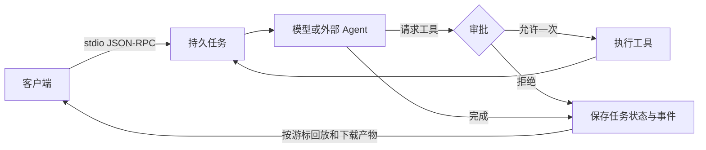

# Fliuno

**面向工作任务与交付物的 Rust Agent 内核。**

Fliuno 把模型、工具和外部 Agent 接进同一套任务流程。任务可等待人工审批，事件和交付物持久保存，客户端重连后可以接着读。桌面端和 CLI 可通过本机 stdio JSON-RPC 接入。

`内核 0.0.2` · `应用协议 0.1` · `Windows / Linux`

[快速开始](#快速开始) · [文档首页](docs/README.md) · [应用协议](docs/protocol.md) · [版本更新记录](CHANGELOG.md)

## 快速开始

从仓库根目录运行离线演示。需要 Rust 1.89 或更新版本、系统 C/C++ 构建工具及 Python。演示使用临时工作区和内置模型，不需要 API key。

```sh
python examples/demo.py
```

接入自己的客户端时，从仓库根目录启动应用服务。

```sh
cargo run -p fliuno-app-server -- --db .fliuno/kernel.db
```

在 stdin 发送以下 JSON-RPC 请求，并以换行结束。响应从 stdout 返回。

```json
{"jsonrpc":"2.0","id":1,"method":"initialize","params":{"protocolVersion":"0.1","clientName":"my-client"}}
```

握手后用 `workspace/open`、`session/create` 和 `task/start` 创建任务。完整的调用顺序、模型配置和离线示例见 [运行与配置](docs/setup.md)。

## 内核能力

| 能力 | 你可以做什么 |
| --- | --- |
| **任务与审批** | 按工作区和会话查找任务，允许一次或拒绝工具调用，重启后查询审批决定。 [应用协议](docs/protocol.md) |
| **交付物** | 将文本和二进制保存为产物，分页查看目录，分段下载并校验 SHA-256。 [产物查询与下载](docs/protocol.md#方法) |
| **模型与 Agent** | 接入 OpenAI、Anthropic、Gemini，以及 MCP 工具、ACP 本机 Agent 和 A2A 远端任务。 [集成文档](docs/README.md#接入模型和工具) |
| **本机执行** | 由宿主注册命令和 PTY，按操作授权。Windows 提供 AppContainer 和 Job，Linux 提供 Landlock、seccomp 和 cgroup v2。 [沙箱与进程边界](docs/sandbox.md) |

## 工作流



任务快照、审批决定和事件由 SQLite 保存。隔离与资源限制由宿主配置确定，受批准的调用仍绑定注册身份。模块职责和状态机见 [内核架构](docs/architecture.md)，配置变更的授权规则见 [注册身份](docs/authority.md)。

## 开发与验证

在仓库根目录运行 `pwsh -File scripts/check.ps1` 可检查格式、Clippy、全工作区测试、应用协议 Schema 和离线演示。解释器演示的依赖和独立运行方式见 [检查与演示](docs/setup.md#检查与演示)。

[开发路线图](docs/roadmap.md) · [测试记录与性能数据](docs/execution-evidence.md) · [协议调研](docs/research.md)
