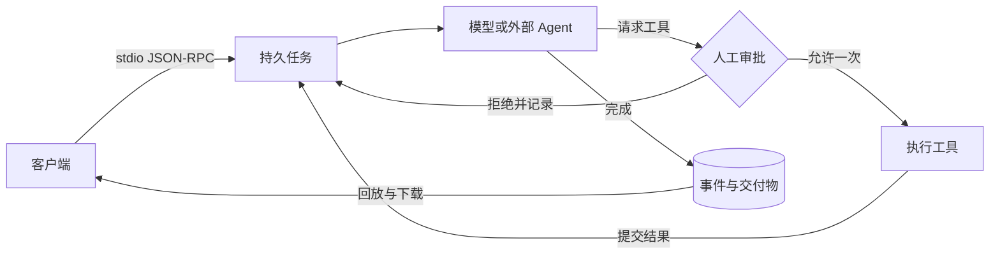

# 

<div align="center">

**面向工作任务与交付物的 Rust Agent 内核**

[快速开始](#快速开始) · [文档中心](docs/README.md) · [应用协议](docs/protocol.md) · [更新记录](CHANGELOG.md)

</div>

Fliuno 把模型、工具和外部 Agent 接进同一个任务流程。任务可以停下来等待人工审批，事件和交付物会保存到本地。客户端断线重连后，可以从上次读到的位置继续。

> **内核 `0.0.3` 开发中** · 应用协议 `0.1` · Windows / Linux

## 快速开始

**跑一次离线任务。** 在仓库根目录执行下面的命令。需要 Rust 1.89 或更新版本、系统 C/C++ 构建工具及 Python。演示使用临时工作区和内置模型，无需 API Key。 [环境与配置](docs/setup.md)

```sh
python examples/demo.py
```

**接入自己的客户端。** 启动本机应用服务后，通过 stdin 发送逐行 JSON-RPC 请求，从 stdout 读取响应。

```sh
cargo run -p fliuno-app-server -- --db .fliuno/kernel.db
```

```json
{"jsonrpc":"2.0","id":1,"method":"initialize","params":{"protocolVersion":"0.1","clientName":"my-client"}}
```

握手后依次使用 `workspace/open`、`session/create` 和 `task/start` 创建任务。 [应用协议](docs/protocol.md) · [Rust 调用方](docs/protocol.md#rust-调用方)

## 内核能力

| 你可以做什么 | 相关文档 |
| --- | --- |
| 在工作区和会话中管理任务，对工具调用逐次批准或拒绝 | [内核架构](docs/architecture.md) · [注册身份](docs/authority.md) |
| 用游标回放任务事件，分段下载交付物并校验 SHA-256 | [应用协议](docs/protocol.md) · [AG-UI 事件投影](docs/ag-ui.md) |
| 接入 OpenAI、Anthropic、Gemini，或把任务和工具交给外部服务 | [模型、工具与 Agent](docs/README.md#模型工具与-agent) |
| 由宿主注册命令和 PTY，并按平台配置进程隔离与资源限制 | [本机执行与隔离](docs/README.md#本机执行与隔离) |

## 一项任务如何运行



任务状态、审批决定、事件和交付物保存在 SQLite 中。Rust 客户端可以在一次调用里建立实时订阅和历史回放窗口，也可以把持久任务事件投影成 AG-UI 事件对象。 [客户端接入](docs/README.md#接入客户端)

## 开发与验证

在仓库根目录运行 `pwsh -File scripts/check.ps1`，检查格式、Clippy、工作区测试、应用协议 Schema 和离线演示。 [检查与演示](docs/setup.md#检查与演示)

[开发路线图](docs/roadmap.md) · [验收与性能记录](docs/execution-evidence.md) · [协议调研](docs/research.md)
