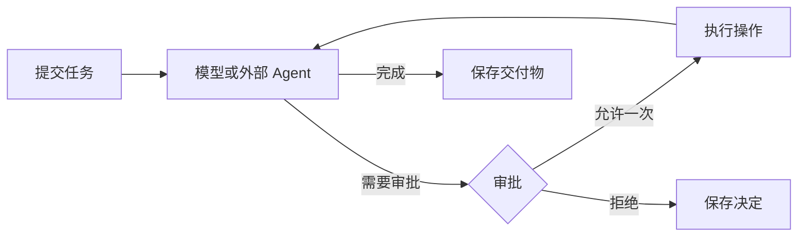

<p align="center">
  
</p>

# 面向工作任务的 Rust Agent 内核

Fliuno 帮你把「交给 Agent 一件事」变成可以审批、追踪和继续的工作。宿主提交任务，模型负责推进，涉及权限的操作暂停等待审批；完成后，客户端可以从本地读取交付物和完整的事件记录。

**[快速开始](#快速开始)** · **[文档中心](docs/README.md)** · [应用协议](docs/protocol.md) · [更新记录](CHANGELOG.md)

`0.0.3` 开发中 · [已发布 `0.0.2`](CHANGELOG.md#002) · 应用协议 `0.1` · Windows / Linux

## 快速开始

### 跑一次离线任务

在仓库根目录运行。需要 **Rust 1.89+**、C/C++ 构建工具和 Python。脚本会启动本机服务，用内置模型和临时数据库完成整个流程，无需 API Key。

```sh
python examples/demo.py
```

预期输出（节选）：

```text
Task: waiting_approval
Proposed tool: artifact_create
Result: completed
Artifacts: 1
```

示例客户端批准一次工具调用，然后读回交付物和事件。也可以运行 `python examples/demo.py --deny` 对照拒绝后的结果：任务结束，未生成交付物。

[环境与配置](docs/setup.md) · [示例源码](examples/demo.py)

### 接入自己的客户端

应用服务通过 stdin 和 stdout 收发逐行 JSON-RPC。启动服务后，向 stdin 发送下面的握手请求：

```sh
cargo run -p fliuno-app-server -- --db .fliuno/kernel.db
```

```json
{"jsonrpc":"2.0","id":1,"method":"initialize","params":{"protocolVersion":"0.1","clientName":"my-client"}}
```

从返回的 `capabilities` 确认可用能力，再调用 `workspace/open`、`session/create`、`task/start`。Rust 宿主可以直接用类型化客户端；需要 HTTP 和 SSE 时，可以在自己的宿主中挂载 AG-UI 路由。

[stdio 接口](docs/protocol.md#传输) · [Rust 客户端](docs/protocol.md#rust-调用方) · [AG-UI HTTP](docs/ag-ui.md#http-接入)

## 一项任务如何运行



任务状态、审批、事件和交付物由 SQLite 持久保存。客户端断线后可以补读历史并接上实时事件。

| 你在做什么 | Fliuno 提供的能力 |
| --- | --- |
| 搭工作台 | [任务计数和待审批快照](docs/protocol.md#工作台快照)、[会话历史](docs/context.md#会话历史分页)、[事件补读](docs/protocol.md#rust-调用方) |
| 接模型、工具或 Agent | [OpenAI、Anthropic、Gemini](docs/setup.md#真实模型)，以及 [MCP、ACP、A2A](docs/README.md#模型工具与-agent) |
| 运行本机程序 | [宿主注册的命令和 PTY](docs/README.md#本机执行与隔离)，按平台配置隔离和资源预算 |
| 收取交付物 | [固定目录水位、分段下载与 SHA-256 校验](docs/protocol.md#审批事件与产物) |

## 开发与验证

```powershell
pwsh -File scripts/check.ps1
```

一条命令检查格式、Clippy、工作区测试、应用协议 Schema 和离线演示。

[内核架构](docs/architecture.md) · [验收与性能记录](docs/execution-evidence.md) · [开发路线图](docs/roadmap.md)
