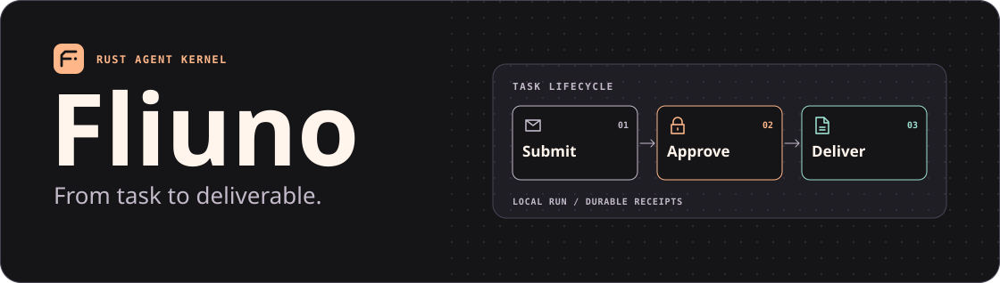

<p align="center">
  <picture>
    <source media="(max-width: 600px) and (prefers-color-scheme: light)" srcset="docs/assets/fliuno-cover-compact-light.svg">
    <source media="(max-width: 600px)" srcset="docs/assets/fliuno-cover-compact.svg">
    <source media="(prefers-color-scheme: light)" srcset="docs/assets/fliuno-cover-light.svg">
    
  </picture>
</p>

# Fliuno

**在终端里和 AI 一起完成工作。** Fliuno 是一款本机优先的 AI 工作台。在自己的文件夹里提交任务，查看计划，在需要时补充要求和批准操作，最后打开或保存交付物。关掉终端后，可以重新打开已保存的工作。

`Windows` · `Linux` · `Rust TUI`

**[快速体验](#快速体验)** · [使用指南](docs/workbench.md) · [文档中心](docs/README.md)

当前版本 **v0.0.16** · [GitHub 下载](https://github.com/AuronaLabs/Fliuno/releases/tag/v0.0.16) · [更新记录](CHANGELOG.md#0016)

## 快速体验

从发布页下载对应平台的压缩包，把 `fliuno` 和 `fliuno-app-server` 保留在同一目录。进入该目录，在终端启动离线演示，无需 API Key：

```sh
./fliuno --demo
```

Windows PowerShell 可用 `.\fliuno.exe --demo`。创建一个会话，按 `N` 写任务、`Ctrl+S` 提交；等到审批出现后，按 `Enter` 查看本次操作，选择允许一次或拒绝。完成后按 `V` 打开交付物目录。[全部快捷键和数据库位置](docs/workbench.md)

按 `Shift+I` 查看当前工作区各会话的待办，按 `Shift+H` 搜索已完成的历史并跳回原任务。按 `F1` 或 `/` 搜索当前可用的命令。主界面显示当前任务对话，按 `Tab` 展开详情，按 `Shift+L` 浏览完整任务列表。主题可在配置文件中选择。

| 工作流 | 快捷键 |
| --- | --- |
| 浏览当前会话的任务 | `Shift+L` 打开完整列表，支持按状态筛选及翻页。 |
| 审阅计划后开始实施 | `F2` 切换计划模式，任务完成后 `Shift+P` 创建实施草稿。 |
| 安排后续工作 | `Ctrl+E` 入队，`Shift+Q` 查看并启动下一项。 |
| 探索另一条思路 | `B` 从当前会话分支，`Shift+B` 以所选的已完成任务为边界。 |
| 查看工具和预算 | `T` 打开时间线，`C` 查看上下文和记忆用量。 |

## 开始真实工作

先运行 `fliuno --init-config` 生成 `~/.fliuno/config.toml`，再填写 OpenAI、Anthropic 或 Gemini 的模型和密钥文件。在要工作的文件夹启动 `fliuno`，或通过 `--workspace PATH` 选择文件夹。模型请求发送到所配置的供应商；会话、审批和交付物保存在本机。[模型配置](docs/workbench.md#接入模型)

## 工程能力

| 能力 | 说明 |
| --- | --- |
| **任务协作与审批** | 模型可以发布计划和请求澄清。客户端可中途补充要求、为精确的本机只读操作设置限时授权，并在重连后查看下一步。[应用协议](docs/protocol.md#任务计划与澄清) |
| **任务与 Agent 调度** | SQLite 持久化任务、审批、交付物和 Run 依赖图，支持并发调度、期限和断线续读。[Run 协议](docs/protocol.md#持久-run-dag) |
| **模型与上下文** | OpenAI、Anthropic、Gemini 支持 Token 预检和自动上下文压缩。会话可检索工作区长期记忆。[会话上下文](docs/context.md) · [工作区记忆](docs/memory.md) |
| **工具与外部 Agent** | 兼容两代 MCP，包括 Tasks、OAuth 和资源监听，并接入 ACP 和 A2A。[MCP 兼容与配置](docs/mcp.md) |
| **本机执行** | 由宿主注册工作区文件、命令和终端能力；支持的平台可启用进程隔离。 |
| **恢复与诊断** | 提供 SQLite 一致性备份、独立路径还原、JSONL 追踪和可选的 OTLP 导出。[备份](docs/backup.md) · [执行诊断](docs/setup.md#执行诊断) |
| **客户端协议** | 提供 stdio JSON-RPC、Rust 客户端及可嵌入的 AG-UI HTTP / SSE 路由。 |

## 开发与验证

```powershell
cargo build --locked -p fliuno-tui -p fliuno-app-server
./target/debug/fliuno --demo
pwsh -NoProfile -File scripts/check.ps1
```

工程检查覆盖格式、Clippy、工作区测试、应用协议 Schema 和离线演示。

[架构与模块](docs/architecture.md) · [验收记录](docs/execution-evidence.md) · [数据库升级验证](docs/setup.md#版本升级验证) · [开发路线图](docs/roadmap.md)
