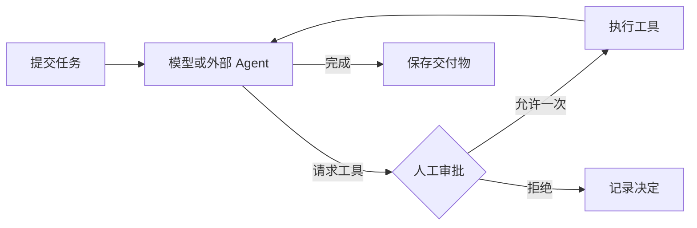

<p align="center">
  
</p>

# 面向工作任务的 Rust Agent 内核

Fliuno 是为工作型 Agent 应用准备的 Rust 内核。宿主提交任务，模型和工具负责执行，人可以在关键步骤审批。任务状态和交付物保存在本地，客户端断线后可以从上次的位置继续读。

[快速开始](#快速开始) · [文档中心](docs/README.md) · [应用协议](docs/protocol.md) · [更新记录](CHANGELOG.md)

**`0.0.3` 开发中** · [已发布版本 `0.0.2`](CHANGELOG.md#002) · 应用协议 `0.1` · Windows / Linux

## 快速开始

### 跑一次离线任务

在仓库根目录运行。需要 **Rust 1.89+**、系统 C/C++ 构建工具和 Python。脚本会启动本机服务、调用内置模型，并在临时数据库里跑完一次任务，无需 API Key。

```sh
python examples/demo.py
```

预期输出（节选）：

```text
Task: waiting_approval
Proposed tool: artifact_create
Result: completed
Artifacts: 1
```

示例客户端批准一次工具调用，任务随后生成一份交付物。脚本最后还会回放事件。加上 `--deny`，可以看到相同的任务在拒绝后结束，且没有生成交付物。

[环境与配置](docs/setup.md) · [离线示例源码](examples/demo.py)

### 接入自己的客户端

应用服务通过 stdin 和 stdout 收发逐行 JSON-RPC。启动服务后，发送下面的握手请求：

```sh
cargo run -p fliuno-app-server -- --db .fliuno/kernel.db
```

```json
{"jsonrpc":"2.0","id":1,"method":"initialize","params":{"protocolVersion":"0.1","clientName":"my-client"}}
```

握手返回 `capabilities`。依次用 `workspace/open` 打开工作目录、用 `session/create` 建立会话，再用 `task/start` 提交任务。不想自行处理 JSON-RPC，可以用类型化 Rust 客户端；要从浏览器等 HTTP 客户端接入，可以在宿主中挂载 AG-UI 路由。

[stdio 协议](docs/protocol.md) · [Rust 客户端](docs/protocol.md#rust-调用方) · [AG-UI HTTP](docs/ag-ui.md#http-接入)

## 一项任务如何运行



任务状态、审批决定、事件和交付物都保存在 SQLite。重连时，客户端可以把历史回放接到实时订阅；下载时，可以分段读取交付物并校验 SHA-256。

| 想进一步了解 | 从这里读 |
| --- | --- |
| 事件游标、断线续读与产物下载 | [Rust 客户端](docs/protocol.md#rust-调用方) · [从 SSE 游标续传](docs/ag-ui.md#sse-输出与续传) |
| OpenAI、Anthropic、Gemini 和外部工具、Agent | [模型配置](docs/setup.md#真实模型) · [MCP / ACP / A2A](docs/README.md#模型工具与-agent) |
| 宿主注册命令和 PTY、平台隔离与资源预算 | [本机执行与隔离](docs/README.md#本机执行与隔离) |
| Rust 模块、状态机和持久化边界 | [内核架构](docs/architecture.md) · [注册身份与授权](docs/authority.md) |

## 开发与验证

```powershell
pwsh -File scripts/check.ps1
```

检查格式、Clippy、工作区测试、应用协议 Schema 和离线演示。Windows 和 Linux 上已实测的功能及复现方式见验收记录。

[检查与演示](docs/setup.md#检查与演示) · [验收与性能记录](docs/execution-evidence.md) · [开发路线图](docs/roadmap.md)
