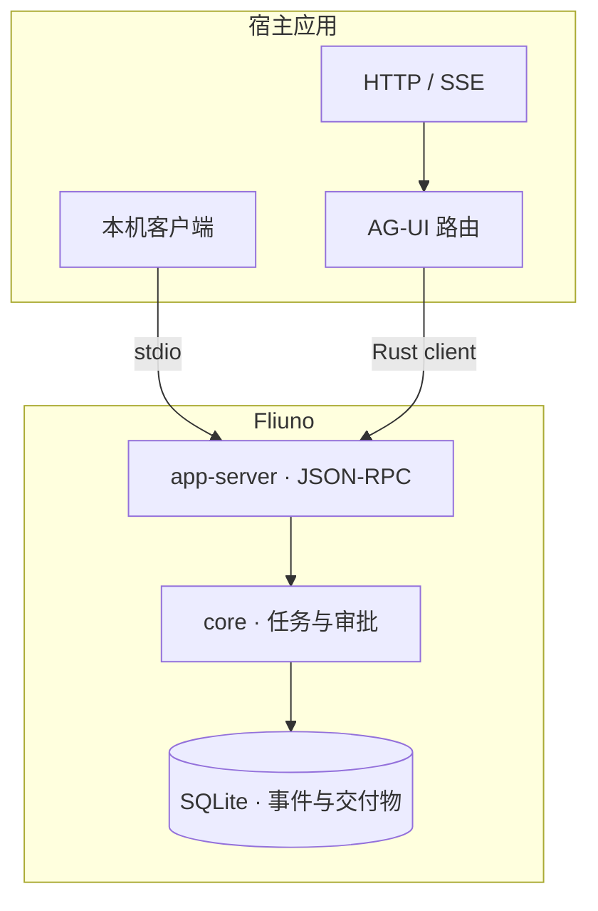
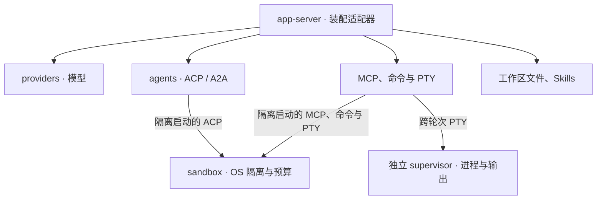
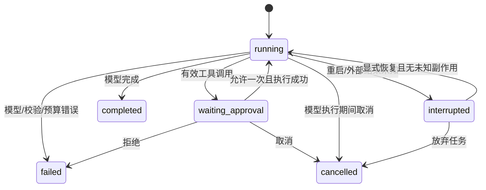

# 内核架构

[文档中心](README.md) › [内核与开发](README.md#内核与开发) · [应用协议](protocol.md) · [运行与配置](setup.md)

`app-server` 接收请求，`core` 管理任务、审批和事务，可替换的适配器连接模型、工具与 Agent。

| 你想了解 | 从这里读 |
| --- | --- |
| **请求如何流转** | [服务、内核与适配器](#领域与依赖) → [任务状态机](#状态机) |
| **代码改在哪里** | [Rust 工作区模块](#rust-工作区模块) |
| **故障或权限变化时会怎样** | [事务和失败语义](#事务和失败语义) · [权限边界](#权限边界) |

## 领域与依赖

### 请求如何进入内核

Rust 客户端直接使用应用协议。HTTP 路径由宿主先授权会话，再用同一个 Rust 客户端访问应用服务。协议对象和 JSON Schema 由 `fliuno-protocol` 定义。

### 执行能力如何注册

模型、Agent 和工具适配器实现各自的执行接口。应用服务把它们注册给 `core`；内核负责决定何时运行、何时等待审批、何时提交结果。PTY 的监督进程独立持有终端和输出账本。

`Workspace` 是用户指定的工作根目录；`Session` 属于一个工作区；`Task` 是一次执行；`Approval` 精确绑定任务和不可由客户端替换的工具调用；`Artifact` 是可审阅的交付物；`Event.sequence` 是数据库内单调递增的全局回放游标。

数据库连接与所有 SQL 放在 storage 模块；状态机负责流程；provider、tool、policy 分开定义接口。app-server 只做参数解码、错误映射和对象组装。

core/registry 为单项与整组工具注册提供同一验证入口。所有组先暂存并校验名称、注册摘要和内外重复，再一次发布；失败保留原注册并丢弃本次暂存对象。工作区、Skills、MCP、exec 和终端复用这一边界，适配器仍负责配置解析和连接生命周期；初始化 IO 不因此具有事务回滚保证，见[注册身份](authority.md)。

app-server 的 configuration 模块统一有界读取五类宿主 JSON 并脱敏解析诊断，全部反序列化在数据库与适配器初始化前完成。它不负责各协议的语义与权限判断；注册配置仍分别属于 MCP、Agent、exec 和 terminal 适配器，见[启动配置](host-configuration.md)。

Skills 分成 frontmatter、catalog、resources 和工具适配层。catalog 固定每个已发现技能的目录句柄与来源摘要，resources 负责逐级无链接解析、单层有界列举和原始字节读取，再生成 UTF-8 文本或显式 base64 与内容摘要；工具层复用 core 的普通审批。指令、参考资料、二进制资源和脚本内容作为不受信数据返回，不授予进程或其他工具权限，见[Skills](skills.md)。

外部 Agent 有共同的运行、观察和取消边界。ACP 持有隔离本机进程；A2A 持有主机预选的远程端点。A2A wire crate 不依赖 core、sandbox 或 providers，适配器把远程任务身份/状态转换为中性 `AgentRemoteTask`，最终产物经 core 的有界事务导入。远端产物 URL 与 metadata 是数据；本地工具权限不能从协议响应产生。详见 [A2A](a2a.md)。

跨任务历史分为三层：protocol 定义中性的 TaskContext，core/context 负责完整任务选择、选项规范化与提示数据编码，storage/context 维护完成记录索引及迁移。默认取最近连续后缀，也可按 taskIds 显式选择同会话已完成记录；显式选择整体超预算则拒绝，不丢弃指定项。TaskCompleted 与历史投影原子提交，创建任务时捕获有界快照，之后的并发完成、重启和恢复不修改输入。模型与 Agent 后端只消费已冻结快照；供应商续接留在当前 Task.messages 内，旧审批和来源 context 不进入投影。v5 引入索引，v9 增加显式选择且不重写旧快照；选择、预算与迁移见 [会话上下文](context.md)。

## Rust 工作区模块

| crate | 职责 |
| --- | --- |
| `fliuno-protocol` | 版本、请求参数、领域对象、事件与 Schema |
| `fliuno-core` | 执行状态机、审批策略、工具注册、SQLite 事务与恢复 |
| `fliuno-providers` | OpenAI Responses / Anthropic Messages / Gemini Interactions 的 HTTP 与消息转换 |
| `fliuno-mcp` | 官方 Rust SDK 驱动的 MCP stdio / Streamable HTTP、工具与资源/提示适配 |
| `fliuno-acp` | 独立 ACP v1 客户端；会话、流式更新、单次权限、文件请求与取消 |
| `fliuno-a2a` | 独立 A2A 1.0 JSON-RPC 客户端；有界请求、消息/任务/产物校验与取消 |
| `fliuno-agents` | 外部 Agent 后端；ACP 隔离进程/文件代理与 A2A 远程任务/产物投影 |
| `fliuno-exec` | 主机注册的原生命令、逐任务审批、stdin/双流输出预算、超时取消与进程树回收 |
| `fliuno-terminal` | 持久 PTY 监督进程、本机 IPC、逐操作审批、有界字节 spool、输出订阅与保留身份的归档回收 |
| `fliuno-sandbox` | 原生启动与进程所有权；Windows host/AppContainer 共享 Job/reactor、Linux Landlock/seccomp、私有目录与受限句柄继承 |
| `fliuno-tools` | 工作区目录分页、元数据、文本和二进制读取、流式 SHA-256、文件创建和有基线校验的编辑 |
| `fliuno-skills` | Agent Skills 元数据、指令与资源按需读取，单技能目录能力和来源绑定 |
| `fliuno-client` | 本机 Rust stdio 客户端，支持握手、类型化调用、通知和 AG-UI 事件投影 |
| `fliuno-ag-ui-http` | 可嵌入宿主的 AG-UI HTTP 路由与 SSE 输出，使用 Rust 客户端访问内核 |
| `fliuno-app-server` | JSON-RPC 分发、stdio 传输、配置组装；不承载业务逻辑 |

## 状态机

默认每个工具调用都需要审批。审批中的参数来自数据库，不接受客户端在响应中换参数。重复、跨任务、已取消任务的审批都返回冲突。策略在提议和执行前各检查一次。

## 事务和失败语义

- SQLite 外键确保关系存在，WAL 与 FULL synchronous 用于持久化；数据库 sidecar 文件锁防止两个进程同时接管恢复。
- 所有工具都在有界后台 worker 中执行，不持有 SQLite 内核锁；审批响应先持久化决定和 `inFlightTool`，随后返回。worker 在副作用前再次检查任务状态与策略，并提交 `tool_started` 后再调用工具。
- `artifact_create` 仅准备内部产物，在一个事务里提交产物、工具结果、任务快照和事件。事务失败时不会只出现其中一部分。
- 工具返回后另一个事务记录已知结果；崩溃、超时、取消或传输失败会阻止迟到结果覆盖终态。存在 `inFlightTool` 的中断任务要求人工核对并取消，不会自动重放。
- 工具错误区分已知失败与结果未知。外部连接中断、写入或同步失败等结果未知会保留 `inFlightTool`；明确的打开失败等已知失败终止任务并清除未知标记。
- 有 `inFlightTool` 的中断任务禁止自动恢复。当前需要操作者核对远端实际结果后取消任务；尚未实现结构化对账接口。
- 等待审批的任务在重启后保持等待；正在运行的任务转为中断，不会在启动过程中自动调用模型或工具。
- JSON-RPC 请求 ID 只用于关联响应。`task/start` 支持会话内 `clientRequestId` 幂等键，与任务、冻结上下文和初始事件原子提交；相同 key、输入、后端和上下文选项返回原任务，不再次执行。更换其中任意项使用同 key 会冲突。客户端可通过分页查询工作区、会话和任务恢复页面状态。

## 权限边界

模型请求期间中断会持久化模型不确定标记并追加 model_outcome_unknown 审计事件。task/resume 必须显式传 retryUncertainModelStep: true 才会重试；供应商不提供幂等保障时，重试可能重复计费或推理。

内置文件工具从任务/会话关系解析工作区，使用 `cap-std` 目录句柄约束实际 IO。拒绝绝对路径、遍历、Windows ADS/设备名等语法；创建文件使用原子的 `create_new`，不覆盖现有目标。文本与显式 `workspace_read_bytes` 共用有界读取；字节工具只返回 base64 原文与原始长度/SHA-256，不检查格式、解码或执行，并仍逐次审批。`workspace_patch_text` 只接受绑定到当前文件 SHA-256 的单文件 diff，审批事件保存可供客户端渲染的原始 diff；执行时通过文件句柄复核基线，以不跟随符号链接方式打开最终文件，并在 Windows/Unix 上拒绝多硬链接目标。文件句柄原位更新以保留现有权限；写入/同步失败会记录未知结果，阻止自动重放。本进程内的新建和补丁串行执行，但不会锁住外部写入者，外部并发编辑不具备事务性保证。这些能力边界只约束内置文件 IO。

tools/file_io 独立承接文本读取、补丁基线与全文写入预览的有界字节读取：核验打开后的普通文件和元数据大小，再分块检查实际字节数与取消；增长中的文件最多读取预算外一字节，失败不返回部分成功。Unix 已存在文件使用 O_NONBLOCK 打开，使 FIFO 可以在等待对端之前被识别和拒绝；它不提供普通磁盘或网络文件系统 IO 的硬 deadline。最终文件的 nofollow 和多硬链接写入检查仍由写入层负责。

`fliuno-sandbox` 独立于任务、审批和 MCP。Windows 后端使用全新的 AppContainer；Linux 后端要求 Landlock ABI 6 并叠加 seccomp，均在私有目录启动、拒绝宿主 workspace 和网络访问。Linux 允许系统运行目录只读与执行，Windows 仍受共享系统资源 ACL 控制。平台 FFI 限定在该 crate 的 windows/linux 模块，unsafe 块须附安全说明；其余 crate 继续禁止 unsafe。启动失败不会回退到宿主进程。Linux 有可写委派 cgroup v2 时，由独立 guardian 回收包括 `setsid` 后代在内的整树；可选资源预算通过宿主指定的 `linuxCgroupParent` 应用，控制器缺失时拒绝启动。普通 sandbox 的 guardian 绑定宿主 pidfd，terminal guardian 在 exec 前交接到 worker pidfd，主服务退出后仍可监控独立终端。交接失败拒绝执行；Linux 硬杀行为探针已进入 Ubuntu CI，仍待 runner 验证。详细保证与限制见 [沙箱边界](sandbox.md)。

MCP stdio 配置必须显式选择 `trusted_host`、`windows_app_container` 或 `linux_landlock`。前者继续使用宿主用户权限；后两者禁止宿主 cwd，使用私有目录和空白环境。传输层拥有子进程，关闭/Drop/超时/取消都触发平台可提供的回收。exec/MCP/ACP 共用 sandbox 的 `assets` 清单暂存脚本、DLL 与数据，先校验复制内容再启动；资源模块独立于任务状态机。MCP 工作区代理、Linux guardian 的实际 runner 验收和 macOS 后端仍是后续工作，见[伴随文件](runtime-bundles.md)。

`core/authority` 提供域分离、类型与长度分帧的注册摘要，工具审批和排队 Agent 任务在持久层分别保存绑定。MCP/ACP/A2A 适配器冻结实际环境/凭据并把完整配置纳入摘要，启动前检查同名注册是否仍一致。sandbox 的 program 模块独立负责有界程序 hash 与实际复制字节核验。v8 保留旧快照的可读性但不补造旧授权；默认 trait 的公开契约摘要及自定义实现要求见[注册身份](authority.md)。

`fliuno-sandbox` 的可选 `async-io` 模块负责 exec/MCP/ACP 共享的原生父端管道：Windows IOCP、Linux 非阻塞 pipe，输入完成与 EOF/error 各有证据，stdout/stderr 不借用 Tokio 文件线程池。Windows trusted host 与 AppContainer 共用 launch/process/inheritance/reactor 模块，策略分别准备 cwd/环境、可选 profile 和 Job 预算；共享所有权不会把宿主路径转换为隔离权限。Unix host 保留 Tokio process + 进程组。同步启动和 PTY 服务保持独立。原生执行报告的首次停止原因与最终清理状态分别记录，数据库只持久保存结果，不承担 OS 句柄管理，见 [执行证据](execution-evidence.md)。

`fliuno-mcp` 将 stdio 启动与 Streamable HTTP 连接收敛为同一工具接口；配置解析和 URL/头部校验先于网络或子进程 IO。HTTP 使用官方 `rmcp` 3.11 SDK 承担版本协商与 JSON/SSE 编解码，发现结果进入与本机工具相同的 Schema 校验、审批和持久事件状态机。host 模块统一服务器所有权、请求排队、取消与有界关闭；content 模块按服务能力注册资源/模板/提示工具，独立校验参数和结果预算。内容请求一次取一页，URI 与提示角色保留为普通工具数据。工具调用遇到受支持的 MRTR 表单输入时，核心可持久暂停原获批调用，待用户响应后绑定相同工具身份和参数续接；续接令牌不进入公开任务或事件。调用超时、取消或传输失败后的副作用保持未知，禁止透明重放。OAuth、订阅及其他 server-to-client 交互仍待扩展，见[内容通道](mcp-content.md)。

Skills 只在主机明确配置的目录中发现，先返回元数据再按名称读取指令。读取上限 128 KiB；目录名与 frontmatter 名称需匹配。技能文本不改变权限策略，也不自动执行其中的脚本。

模型输出、文件和工具返回都是不可信输入。命令只能来自 app-server 启动时由主机注册的固定程序；模型不能创建 executable 或 shell 命令，只能提供受限 argv 和 stdin。每次命令调用经过同一逐次审批与持久调用身份校验。`trusted_host` 具有当前操作系统用户的完整权限，进程组/Job 只负责结束命令及后代，不提供文件或网络隔离；Windows AppContainer 与 Linux Landlock/seccomp 是分平台受限程序路径。API 凭据不进入 Task、Event 或 Artifact，HTTP 非成功响应正文也不写入数据库。

## 当前执行方式与后续演进

app-server 使用容量 32 的有界队列和 4 个固定 worker，最多同时运行 4 个独立任务步骤；单个任务仍限制为一个在途步骤。模型 provider 必须实现 `Send + Sync`，使独立任务可并行请求。模型和工具 IO 都在数据库锁外执行；模型响应按任务状态和步骤编号核对，工具响应按 `inFlightTool` 调用身份核对，因此取消或恢复后的迟到结果不会覆盖新状态。工具完成后续模型步骤重新进入有界队列；容量耗尽时任务以明确原因进入失败状态，并保留幂等键。

`fliuno-exec` 提供主机固定注册的前台有界命令。独立的 `fliuno-terminal` 按 host preset 创建 PTY supervisor；执行审批先提交，再创建 session 归属的持久记录并启动 supervisor。后者以自身为生命周期 owner，自己的 Windows Job 先于 PTY child 创建，并在 hard crash 时回收子孙；app-server 重启只通过私有本机 IPC 重新观察，不接管或重新执行命令。IPC capability 随私有目录中的描述符保存，SQLite spool 将字节、绝对游标和快照原子提交；PTY 写入先预留持久 operation ID，断线后不能以新身份自动重放。

`fliuno-terminal` 内部分成不可变 host 配置/authority identity、审批 tool adapter、app-side service、版本化 IPC、worker bootstrap/accept loop、单写 lifecycle actor、独立 native PTY read/write worker 和 SQLite spool。app RPC 只读取已存在的 session 记录，不获得 supervisor capability；ACP Agent 不声明终端能力。Windows worker 的 Job 默认限制 32 个活动进程及 1 GiB Job memory，可由 preset 资源预算覆盖；Linux 有可写委派 cgroup v2 时由独立 guardian 在 worker 退出后清理 PTY 子孙，并应用 preset 资源预算；app-server reaper 仍负责正常回收自己的 worker。guardian 隔离在 OS crate 的独立模块，任务状态机和 terminal actor 不承担父进程故障检测。trusted terminal 仍具有宿主用户文件、网络和凭据权限。

终端回收由独立 archive 模块负责，tombstone 账本保留创建身份，spool 清理只删除明确列出的内部文件。客户端的有界 archive/batch 先校验全部 ID，再复用相同单项归档边界；每项有自己的提交与已知/不确定结果，不把多个文件系统操作包装成跨项事务。监督进程持锁时仍拒绝归档，详情见[终端归档](terminal-archive.md)。

终端输出观察使用独立认证 IPC 长连接。actor 提交 spool 后发送可合并的变更提示，订阅模块从绝对字节游标读取已提交页；实时传输无需周期查询。app-server 连接管理器保留每订阅有界队列，轮转输出，慢客户端溢出后保留结束标记和最后写出的游标。重连重新订阅并处理 spool `gap`；离线读取不承诺旧进程存活。传输订阅不进入 core 任务状态机，不影响 PTY 生命周期。

终端保留策略由独立 archive 模块管理，registry 模块持有小型 SQLite 身份账本。归档先持有根锁和 supervisor 所有权锁，提交 tombstone 后才清理 spool 与 endpoint；清理失败由后续有界轮转重试。主机预留和 worker 创建 PTY 前都检查 tombstone，避免归档把旧调用变成可再次执行的请求。只读输出把已归档记录投影为原末尾游标上的空保留窗口；应用协议提供独立分页历史，模型归档仍逐次审批。账本初始化标记阻止丢失或空库被静默重置为无历史状态。

事件事务提交后才向有界内存订阅队列广播。stdio 主循环同时等待请求与事件，向客户端发送事件通知；队列溢出会关闭该订阅并报告最后发送序号。全局事件游标可分页回放，保证事件日志仍是事实来源，通知丢失可由客户端恢复。

取消会持久化终态，并通过 cancellation token 中断 provider HTTP 请求发送或响应读取，也通知正在运行的工具；对端可能已接收请求，因此不能保证撤销计费或外部副作用。同一 MCP 主机的调用串行执行，等候其锁也可取消并计入调用预算；尚未发送请求时返回已知失败，不影响占用主机的其他任务。请求发送后的取消、超时或协议失败会关闭主机并保留未知结果。关闭服务时唤醒并停止调度器、取消当前请求，再将未结束任务记为中断并释放数据库锁。

外部协议只通过独立适配模块扩展，能力协商中不声明尚未完成的功能；不做无限自动重试。

`fliuno-acp` 提供连接级 ACP v1 会话、通知、单次权限、文件请求与取消，复用 sandbox 生命周期，保持不依赖 core 或 provider。`fliuno-agents` 通过 core 的独立 `AgentBackend` 接口接入持久运行、观察事务和多项审批，app-server 负责主机配置与调度装配。每个外部任务拥有独立运行 ID、隔离进程与会话，不能进入 `ModelProvider` 路径。审批意图先提交数据库再交付有界内存通道；重启不重放提示或授权，等待外部权限的任务也必须中断。已启动运行禁止 resume，尚未启动的排队任务可显式恢复。

宿主文件代理分为三层：`acp/filesystem` 只绑定会话、请求种类、容量与到期时间；`agents/filesystem` 将私有虚拟 cwd 下的路径转换为工作区相对路径，准备写入 diff 并调度最多 8 个阻塞作业；`core/agent_tools` 校验注册工具和策略、事务保存独立审批及操作状态。实际 IO 复用 `fliuno-tools` 的目录能力。虚拟 cwd 中没有宿主文件副本，也不授权宿主目录 ACL；Agent 只能通过获批代理获得文件内容。

写提案会先读取宿主基线供客户端审阅，此时不修改文件，也不向 Agent 发送旧内容。执行前持久保存 started，再由工具复核基线；完成结果落盘后才答复 ACP。Agent 的 EndTurn 不能掩盖宿主操作的未知结果。请求使用同一固定截止时间覆盖准备、审批与执行，取消也传递给阻塞作业；操作系统阻塞文件 IO 不能被 Tokio 强行中断，极慢文件系统下不保证严格墙钟回收上限。当前伴随文件、网络和终端限制及完整预算见 [ACP 文档](acp.md)。

---

[文档中心 ↑](README.md) · 接下来：[应用协议](protocol.md) · [持久授权](authority.md) · [验收与性能记录](execution-evidence.md)
