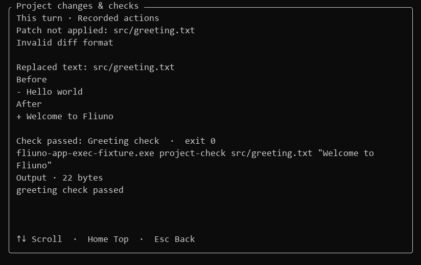
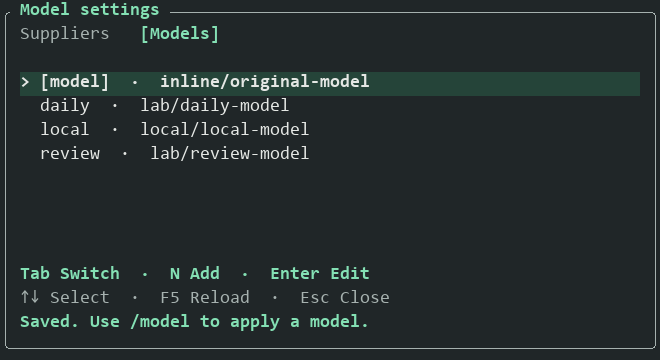
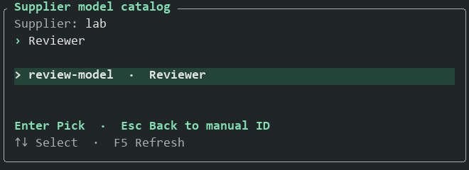

# 使用 Fliuno 终端工作台

[产品首页](../README.md) · [文档中心](README.md) · [更新记录](../CHANGELOG.md)

[安装](#安装) · [接入模型](#接入模型) · [项目工作](#在项目目录里工作) · [切换语言](#切换界面语言) · [恢复与备份](#恢复与备份)

> 本指南以 **v0.0.20** 为安装基线。标为 **0.0.21 开发版** 的章节需要配套的开发版 `fliuno` 与 `fliuno-app-server`。

从项目目录在终端里运行 `fliuno`。首次启动会引导你选择接口、填写可选的 Base URL 并连接 API 密钥。随后可在后台加载的目录里搜索模型：用 `↑` / `↓` 浏览，`Tab` 填入所选模型，`Enter` 保存当前输入的模型 ID。目录不可用时仍可手填。OpenAI 官方接口选 Responses，使用兼容网关或本机服务时按该服务提供的接口选择 Chat Completions。Anthropic 和 Google Gemini 也有各自的原生选项。保存后可直接输入第一条消息，按 `Enter` 发送。`F1` 打开命令搜索，`Esc` 返回对话。用 `Ctrl+N` 或粘贴输入多行。

重开旧会话时可在历史加载完成前按 `Enter` 开始输入，再按 `Enter` 登记发送。底部会显示“Will send when conversation opens”；历史就绪后，同一草稿只发送一次。期间可按 `Esc` 取消发送并保留草稿；修改草稿、打开命令菜单、切走会话、断开或退出也会取消这次发送。

0.0.18 起，在空输入框键入 `/` 会打开常用命令。继续输入以筛选，按 `↑` 或 `↓` 选择，再按 `Tab` 运行。`/new` 开启当前文件夹的新对话，`/resume` 查看该文件夹的已有会话，`/help` 打开完整命令。`Enter` 会把当前输入留在草稿里，可以继续编辑路径或文本。有草稿时按 `F1` 打开命令，按 `Esc` 回到原草稿。

0.0.18 的首次配置可直接粘贴 API 密钥。输入以圆点隐藏。Windows 将密钥存入当前账户的 Windows 凭据管理器，Debian 将密钥存到配置旁的 `credentials` 目录，文件权限为 `0600`。TOML 只保存引用。填写 Base URL 后进入凭据页，此时可按 `F2` 改用已有密钥文件。随后再查询或填写模型 ID。

对话顶栏显示已连接的模型。流式回复和重新打开的会话共用 Markdown 排版，支持标题、列表、行内代码和代码块。窄终端会折行显示代码。

两份程序 `fliuno` 和 `fliuno-app-server` 可放在同一目录，也可使用 `--server PATH` 指定服务。要离线体验，显式运行 `fliuno --demo`，在演示会话中用 `Ctrl+S` 发送。

| 操作 | 按键 |
| --- | --- |
| 命令搜索 | 在工作台按 `F1`，或在输入框外按 `/`，输入关键字筛选当前可用操作，上下键选择，`Enter` 执行。0.0.21 将待审操作置顶，输入 `/plan` 后按 `Tab` 可切换计划模式。 |
| 工作区、会话 | `W` 打开工作区列表，`O` 输入新路径；`S` 打开会话列表，列表中 `N` 新建会话，`F` 按标题或 ID 查找，`Shift+A` 切换归档视图，`R` 改名，`X` 归档或恢复。上下键选择，`Enter` 打开，`PageDown` 读取下一页。 |
| 模型设置（0.0.21 开发版） | 输入 `/settings` 后按 `Tab`，或用 `F1` 搜索 `settings` 进入。连接与模型分开配置；用 `/model` 切换当前档案。 |
| 工作区交付物（v0.0.17 起） | `F7` 浏览当前工作区交付物。`F` 按媒体类型筛选，`Enter` 预览，预览中 `P` 查看上一修订，`D` 保存并显示校验摘要。 |
| 工作区任务中心 | `Shift+I` 打开跨会话收件箱；`1` 待处理、`2` 运行中、`3` 最近结束。选中任务按 `Enter` 回到原会话；待审批项会打开原审批详情。审批有更多页时，移到列表末尾继续读取当前快照。实时更新会刷新列表。`Esc` 返回当前会话。 |
| 历史查找 | `Shift+H` 搜索当前工作区已完成历史；结果按固定水位分页，`PageDown` 读更多，`U` 只搜用户输入，`A` 只搜助手回复，`B` 搜两者。选中结果按 `Enter` 返回任务。匹配是字面子串；列表会显示扫描量和因单条上限而跳过的记录数。 |
| 计划与实施 | `F2` 切换计划模式。计划任务可发布计划、提问，经现有审批流程使用受限的只读工具。选中已完成的计划任务，按 `Shift+P` 生成实施草稿，审阅后按 `Ctrl+S` 提交。 |
| 排队提示 | 草稿中 `Ctrl+E` 入队，`Shift+Q` 查看当前会话的队列。`Enter` 启动首项，`Delete` 删除所选待执行项，`G` 查看阻塞任务，`R` 刷新。 |
| 会话分支 | `B` 从当前会话分支，`Shift+B` 从选中的已完成任务分支。输入名称后按 `Enter` 创建，直接按 `Enter` 可省略名称。分支头部显示来源及继承条数。 |
| 时间线与预算 | `T` 打开任务事件时间线，`Enter` 预览所选事件，`A` 打开仍待处理的关联审批。`PageDown` 继续读取，`R` 更新水位。`C` 查看上下文及记忆用量。 |
| 提交或协作 | `n` 新任务，`i` 补充指令。没有待处理请求时，`Enter` 也可打开草稿。正常对话用 `Enter` 发送、`Ctrl+N` 换行。离线演示和 v0.0.16 用 `Ctrl+S` 发送。其他表单用 `Enter` 提交，`Esc` 返回。 |
| 工作区记忆 | `F6` 打开记忆目录，`F` 搜索，`N` 新建，`Enter` 查看，`E` 编辑。 |
| 草稿上下文 | `F3` 查看本次历史。`s` 切换会话与隔离模式，`m` 控制自动记忆，`h` 在完整记录和仅对话之间切换，`p` 固定或解除历史水位，`r` 刷新。`Esc` 返回草稿，选项随提交或入队保存。 |
| 查看任务 | 上下键滚动对话，`Home` 回到开头，`End` 跟随最新输出。`Tab` 展开或收起任务详情。`Shift+L` 打开本会话完整任务目录，`f` 切换状态筛选，`PageUp` / `PageDown` 翻页，`r` 回到最新一页，`Enter` 打开所选任务。 |
| 处理待办 | `Enter` 或 `A` 打开审批或澄清。审批用 `Y` 允许一次、`N` 拒绝。对于内核只允许拒绝的 Agent 请求，界面只显示拒绝选项。`X` 后按 `Y` 确认取消。 |
| 查看交付 | `V` 打开目录，`Enter` 查看内容与摘要，`D` 输入目标路径保存。文本预览中 `U` 将该版用作新任务输入，`P` 打开上一版（如有）。 |
| 恢复或退出 | 离线时按 `R` 重连。选中中断任务或结果未知的外部运行时，按 `R` 打开恢复面板。小写 `q` 或 `Ctrl+C` 退出。 |
| 连接与配置 | `F5` 查看配置、数据库、模型和当前 app-server 握手状态。 |
| 数据库备份 | `F4` 打开备份面板。`C` 创建，`V` 校验，`R` 还原。 |

草稿支持方向键、`Home` / `End` 和组合字符删除。粘贴会保留多行，等待你按发送快捷键。切换会话时，当前运行最多暂存 8 个其他会话的草稿及附件；已入队的提示保存在 SQLite，重开后仍能访问。队列每个会话最多 16 项，手动启动时会检查是否有运行中、待审批、待答或中断的任务。会话切换会一并暂存草稿的上下文选项。自动记忆在任务开始时根据输入检索。执行后按 `c` 查看实际归因。

在配置文件中设置 `[workbench].theme`。`auto` 跟随终端配色，`dark` 与 `light` 使用固定配色，`mono` 使用单色。`--theme` 可覆盖本次运行。任务状态和审批选项都有文字标签。

关闭工作台会结束它启动的本机服务；重开后可从数据库找回任务和待办。结果未知的外部操作不会自动重发。下载会校验 SHA-256，拒绝覆盖已有文件。文本预览上限 64 KiB，下载上限 32 MiB。

## 切换界面语言

**0.0.21 开发版。** 在空输入框键入 `/language` 后按 `Tab`，或按 `F1` 搜索 `language` / `界面语言`。用方向键选择 **English** 或 **简体中文**，按 `Enter` 保存，再按 `Esc` 回到对话。切换保留草稿和模型连接。中文界面的 F1 仍可搜英文命令名；斜杠命令和按键保持一致。

也可编辑已有配置中的 `[workbench]`：

```toml
[workbench]
language = "zh-CN"
```

默认值为 `en`。使用未配置的离线演示时，切换只在当次运行生效，不会创建用户配置。已覆盖项目主屏、命令搜索、`/settings`、供应商目录、内置操作审阅和 `/changes`。首次配置、旧档案选择器及部分历史管理界面仍显示英文；回复、模型 ID、路径、补丁和进程输出保持原文。

48 列终端也能查询模型、查看将要写入的文件并完成审批：[中文模型目录](assets/language-catalog-v021.png) · [中文审批](assets/language-approval-v021.png)。两张图来自 Windows ConPTY 测试。

## 在项目目录里工作

本节描述 **0.0.21 开发版**。顶栏显示当前项目、路径和模型。可以直接输入：「找到配置读取入口，修改默认日志级别，再运行已配置的检查，给出改动路径和结果。」

1. **定位**：让 Agent 根据文件名或源码字面内容查找相关路径，然后读文件。简单问答直接在对话完成。
2. **审批**：先核对工作区、相对路径、修改前后的内容或补丁。一处精确替换要求原文唯一，并且文件仍是读取时的版本。拒绝不会写入；遇到版本冲突可重读后提交新提案。
   长预览会显示当前可见行范围。用 `↑` / `↓` 滚动，`PageUp` / `PageDown` 翻页，`Home` / `End` 跳到首尾。按 `Tab` 切换[预览与工具参数](assets/approval-details-v021.png)，返回时保留阅读位置；这不会批准或拒绝操作。
3. **检查**：先在用户侧[登记项目检查](setup.md#在隔离环境里运行项目检查0021)。批准前可看到程序、实际参数和输入文件。检查程序在私有目录里运行；输出与退出状态会写进本轮记录。
4. **复核**：按 `d` 或在输入框键入 `/changes` 后按 `Tab`，查看本轮确认写入的文件、未应用的提案和检查输出。完整工作区变化仍可用 `git diff` 查看。托管交付物可预览与另存，项目文件则以实际写入路径为准。



上图来自 80 列 Windows ConPTY 验收，使用模拟模型；保留操作和结果区域。

在文本读取审批中按 `r`，允许本次读取，并在同一会话内为参数完全相同的读取保留一小时授权。`/permissions` 后按 `Tab` 可查看授权，使用方向键选择、`Del` 撤销。补丁和项目检查仍各自审批。

多步骤任务可在 `[workbench]` 中设置 `max_model_steps = 16`（范围 1–32，默认 8）。该上限随任务或队列草稿保存；增大上限可能增加模型调用成本，审批规则不变。

## 安装

从[发布页](https://github.com/AuronaLabs/Fliuno/releases/latest)下载对应平台的一份安装包或便携包，并下载同一版本的 `SHA256SUMS.txt`。校验后再运行安装程序。

- **Windows x64**。打开 `.msi` 并按安装器提示操作。安装会注册系统 PATH。完成后打开新的 PowerShell，在项目目录运行 `fliuno`。
- **Debian amd64**。在下载目录将实际文件名传给 `apt install`，例如 `sudo apt install ./fliuno-v0.0.20-linux-amd64.deb`。完成后进入项目目录，再运行 `fliuno`。
- **便携包**。解压 ZIP 或 tar.gz，在解压目录运行 `fliuno` 或 `fliuno.exe`。可通过 `--workspace PATH` 指定项目目录。

安装后运行 `fliuno --version` 确认版本。如果仍显示旧版本，在 PowerShell 中用 `Get-Command fliuno -All`，在 Debian 中用 `command -v fliuno` 检查当前终端实际找到的文件。便携版用解压目录里的程序路径启动。通过系统卸载原生包会保留用户主目录里的 `~/.fliuno`。

### 校验下载

在下载目录检查 SHA-256。以下使用 v0.0.20 文件名举例；下载其他版本时替换名称。

Windows PowerShell：

```powershell
$asset = 'fliuno-v0.0.20-windows-x64.msi'
Get-FileHash -Algorithm SHA256 -LiteralPath $asset
Select-String -Path SHA256SUMS.txt -Pattern ('  ' + [regex]::Escape($asset) + '$')
```

Debian：

```sh
asset='fliuno-v0.0.20-linux-amd64.deb'
sha256sum -- "$asset"
grep -F -- "  $asset" SHA256SUMS.txt
```

第一条结果是本地文件的摘要，第二条是清单里的记录。应找到一条同名记录，且 64 位十六进制摘要逐位相同（大小写不影响比较）。找不到匹配项或摘要不同时，核对发布版本并重新下载。

### 从旧版升级

1. 在旧版打开 `F4` 备份面板，创建并校验数据库备份。若改过数据库路径，先按 `F5` 确认实际位置。数据库备份包含对话和托管交付物；项目文件、`config.toml` 与系统凭据另行保管。跨机器迁移时，按新机的凭据存储方式重新绑定密钥。
2. 关闭工作台后安装新版，回到原项目目录运行 `fliuno`，检查模型和已有会话。便携版解压到新目录，两份程序使用同一版本。
3. 旧审批如果因工具权限摘要变化而失效，先核对项目文件与已有回执，再把仍需要的操作重新提交。结果未知的远端操作先核对实际状态，避免重复执行。

如果需要回退，按[备份与还原](backup.md#校验与还原)把升级前快照恢复到新路径，再让旧版打开该路径。

## 接入模型

配置位于 `~/.fliuno/config.toml`。Windows 下 `~` 指用户主目录。也可以用 `fliuno --init-config` 创建模板后手动编辑，已有文件会保留。首启可用密钥请求模型目录。目录可访问时可以搜索并选择模型；无目录或不想查询时可以手填模型 ID。目录通过不代表生成权限也已验证。 选模型时按 `F3` 可设置思考强度，省略时采用提供方默认值。

```toml
[workbench]
theme = "dark"

[model]
provider = "openai"
name = "your-model"
api_key_file = "credentials/openai.key"
```

`provider` 支持 `demo`、`openai`、`anthropic` 和 `gemini`。`name` 填账户可用的模型 ID。API key 单独保存为一行文本，示例路径为 `~/.fliuno/credentials/openai.key`。建议只让当前系统用户可读取凭据文件。

0.0.18 允许在同一份 TOML 里定义具名模型。配置 `[workbench].model_profile` 作为默认模型，或用 `fliuno --model-profile lab` 为这次启动指定模型。路径仍相对于配置文件。原来的 `[model]` 可继续作为未指定具名模型时的默认值。

在对话输入框键入 `/model` 并按 `Tab` 打开模型选择器。已有草稿时可通过 `F1` 搜索 `model`，选择后继续编辑草稿。选中的模型用于这个 TUI 进程里随后启动的回复，当前会话和已保存的历史仍可查看。进行中的模型任务和待恢复的工作结束后才能切换。重新连接或退出后，Fliuno 按启动参数与配置文件重新选择模型。

在选择器中按 `F5` 可以检查高亮档案的凭据和远端目录；它不会切换模型或发送生成请求。 按 `Ctrl+S` 将高亮档案保存为**启动默认**，当前模型不变。将 `[model]` 保存为默认可以清除具名档案的偏好。`--model-profile` 仍优先于已保存的默认值。

选择器里按 `F2` 编辑高亮档案的模型 ID 和思考强度。编辑页的 `F5` 查询该档案的目录，`F3` 选择档位，`Ctrl+S` 保存。可以直接输入 ID。此操作保留协议、Base URL、凭据和预算。保存不会切换当前对话。列表中的 `[saved]` 表示这个活动档案有尚未应用的改动，选中它按 `Enter` 才应用。

在选择器中按 `F4` 修改连接，或按 `Ctrl+N` 新增档案。依次选择协议、填写 Base URL、选择凭据并设置模型。已有档案只有在协议和实际 API 地址都没变时才可选择保留凭据。对于本机 Chat Completions，可选择无 Key 直连。用 `F5` 在保存前查询新连接的模型目录，或手填模型 ID；`F3` 设置思考强度。保存后原对话和草稿仍在，按 `Enter` 才启用选定档案。

```toml
[workbench]
model_profile = "office"

[models.office]
provider = "openai"
name = "your-office-model"
api_key_file = "credentials/openai.key"

[models.lab]
provider = "anthropic"
name = "your-lab-model"
api_key_file = "credentials/anthropic.key"
```

### 命名供应商（0.0.21 开发版）

供应商保存 Base URL 和凭据引用；模型档案独立选择供应商、协议、模型 ID 和思考强度。多个档案可以复用同一个供应商。该页需要支持模型设置的本地 app-server。

1. 在空输入框键入 `/settings` 后按 `Tab`，或按 `F1` 搜索 `settings`。在 **Suppliers（供应商）** 页按 `N` 新增连接，或用上下键选中供应商后按 `Enter` 编辑。可选官方预设或填写自定义 Base URL。凭据可选择隐藏输入、已有密钥文件，或为回环连接选择无 Key。
2. 按 `Tab` 切到 **Models（模型）**。按 `N` 新增档案，或用 `Enter` 编辑现有档案；选供应商和协议，输入该服务接受的模型 ID，再设思考强度。`Adapter default` 表示不显式传思考强度。在模型 ID 处按 `F4` 查询已保存供应商的目录，可按 ID 或名称筛选，`Enter` 把所选 ID 填回表单；有下一页时按 `F6`，`F5` 刷新目录。查询失败或网关不提供目录时按 `Esc` 返回，原输入会保留，可继续手填。
3. 在摘要页核对配置，按 `Enter` 保存，或按 `Esc` 返回上一步。配置被其他进程改过时，旧表单不会覆盖新内容。按 `F5` 放弃当前表单并重新加载，再编辑并核对。供应商端点改变时，必须为新地址重新选择凭据。
4. 退出设置后用 `/model` 选择并应用档案。保存和应用不会修改启动默认值；要将档案设为启动默认，在模型选择器按 `Ctrl+S`。已有对话和草稿会保留。





也可直接写入用户配置，例如：

```toml
[providers.fliuno-gpt]
preset = "openai"
api_key_file = "credentials/openai.key"

[providers.local]
preset = "custom"
base_url = "http://127.0.0.1:1337/v1"
auth = "none"

[models.office]
supplier = "fliuno-gpt"
protocol = "openai.responses"
name = "your-office-model"

[models.local]
supplier = "local"
protocol = "openai.compatible"
name = "your-local-model"
```

官方端点预设包括 `openai`、`anthropic` 和 `gemini`。协议 ID 为 `openai.responses`、`openai.compatible`、`claude.message` 和 `google.gemini.interactions`。已有的内联模型连接和旧协议拼写仍可读取。档案引用供应商后，不能再单独覆盖 Base URL 或凭据。本机无 Key 连接仍限于回环地址和 `openai.compatible`。凭据直接录入时，使用首次配置相同的本机存储机制，TOML 只写引用。回复标签会保留发送请求时的 `供应商/模型`，以后切换模型不会改变旧标签。

### 用户配置与状态位置

| 项目 | 默认或覆盖方式 |
| --- | --- |
| 用户配置 | `~/.fliuno/config.toml`。`--config PATH` 可使用其他文件。配置里的相对路径均以该文件所在目录为基准。 |
| 本地状态 | `~/.fliuno/state/workbench.db`。若新路径尚无数据库，已有的 Windows `%LOCALAPPDATA%\fliuno` 或 Linux `$XDG_STATE_HOME/fliuno` 数据库会继续打开。可用 `--db PATH` 或 `[workbench].database` 明确指定。 |
| 离线演示 | `fliuno --demo` 使用独立的 `demo.db`。可以用 `--db PATH` 指定演示库。 |
| 界面语言（0.0.21 开发版） | `[workbench].language`：`en`（默认）或 `zh-CN`。也可由 `/language` 保存。 |
| 服务程序 | 默认使用同目录的 `fliuno-app-server`。可用 `--server PATH` 或 `[workbench].server` 覆盖。 |
| 其他能力 | `[integrations]` 可以引用 `mcp`、`mcp_oauth`、`mcp_oauth_vault`、`acp`、`a2a`、`execution`、`terminal`、`skills`、`memory_embedding` 的宿主配置或目录。 |

```sh
fliuno --workspace ./project
fliuno --config ./trusted-config.toml --workspace ./project
```

`[model].base_url` 和 `[model.budget]` 的用法见[服务配置](setup.md#真实模型)。

v0.0.16 的 Linux 便携包面向 x86-64、glibc 2.34 及以上。v0.0.17 的 Linux 安装包及便携包在 Debian 12 amd64 上构建。发布页的 `SHA256SUMS.txt` 可用 `sha256sum -c SHA256SUMS.txt` 校验已下载的文件；只下载其中一个包时可用 `sha256sum -c --ignore-missing SHA256SUMS.txt`。Windows 用 `Get-FileHash` 计算安装包或便携包的 SHA-256 并与清单对照。

## 恢复与备份

恢复面板显示内核当前的恢复判断。可以恢复时按 `Y` 继续原任务。上一次模型请求结果未知时，确认会重新发送请求，并可能产生额外费用。外部运行已结束且结果未知时，可以按 `O` 录入核实结果。用方向键选择结果，用 `Tab` 在结果、操作者和证据间切换，然后按 `Ctrl+S` 保存。原任务保留原状态，人工核实结果附在审计记录中。

在备份面板选择相应操作后输入路径。创建快照使用新目录，还原使用新数据库路径。完结后面板显示快照摘要、事件水位、任务和交付物数量。要打开已还原的数据库，使用 `fliuno --db PATH` 启动。[备份的数据范围与校验流程](backup.md)

## 配置诊断

在终端运行 `fliuno --doctor` 可检查配置文件、模型名称、凭据文件、数据库和服务路径。它只检查本机文件。配置或路径有问题时会返回非零退出码，并给出对应字段。

运行中的工作台可按 `F5` 查看当前服务握手、启用的 Provider 和可用能力。握手确认的是本机服务连接。检查远端模型目录可使用 [`--check-model`](setup.md#真实模型)。实际生成能力取决于所选模型和服务端。

## 在主屏续聊

v0.0.17 的主屏按会话显示近期消息。长回复默认跟随末尾，完成后输入框会重新聚焦。浏览较早内容时按 `Esc` 离开输入框，再用 `PageUp` 向上翻。到已加载历史的开头继续按 `PageUp`，会加载较早一页并保留原阅读位置。`End` 回到最新消息，`Tab` 查看当前任务的单独详情。很长的对话可以在命令菜单搜索完整工作区历史。

## 跟随任务进度

新任务提交后，工作台默认跟随最新输出。方向键、翻页和 `Home` 切换到手动浏览，`End` 恢复跟随。任务状态、模型尝试、当前工具和审批操作显示在对话上方。

支持流式模型的服务会显示实时文字预览。输出提交后读取持久结果与供应商报告的用量。预览可在中断或服务重连时清空，已提交的结果仍可重开。

## 审阅和选用记忆

记忆面板按当前工作区查找键名和正文，打开条目后可阅读其来源、正文及当前修订号。保存使用当前打开的修订号，冲突时可返回列表刷新后重新编辑。

在草稿中按 `F6`，或在 `F3` 上下文面板选择 `V`。用空格切换所选条目，按 `Ctrl+S` 将选中的修订加到草稿。显式选择会代替本次自动检索，最多八条，并随排队草稿保存。也可以用 `F3` 关闭本次记忆。选中记录被改动后，提交会提示重新选用。任务的 `C` 上下文归因可以查看实际用到的修订号。
